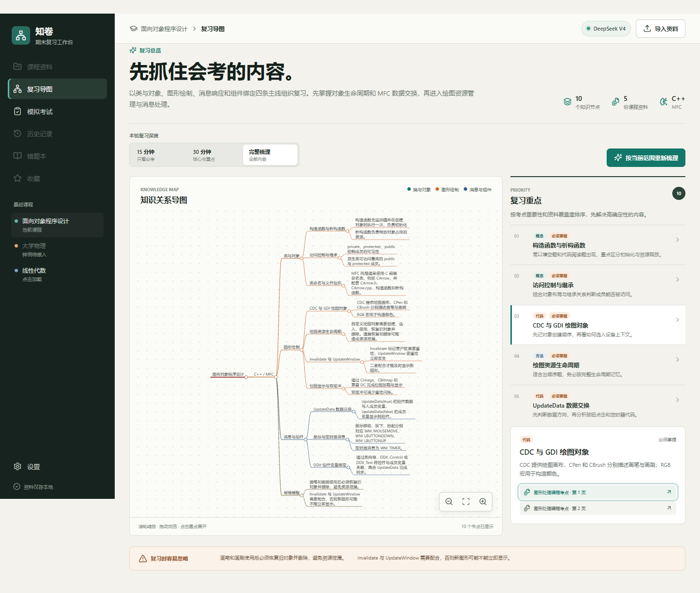

# 知卷 ZhiJuan

面向理工科大学生的本地优先 AI 复习工具。用户使用自己的模型 Key，将课程课件和可选历年真题整理为可追溯的知识图谱、模拟试卷与答题复盘。

GitHub：[yuntianming30/zhijuan](https://github.com/yuntianming30/zhijuan)

> 当前状态：复习导图与模拟考试两个核心模块均已完成可运行纵向链路。



## 当前实现

- 复习知识导图：可缩放、拖动和展开节点
- 复习重点：按重要程度排序，支持查看知识点详情和资料页码
- 复习深度：15 分钟、30 分钟和完整梳理
- 本地 API：上传 PDF、PPTX、TXT、Markdown 和三门验证课程需要的图片格式
- DeepSeek V4：文本生成、公式页面视觉提取和真题结构提取已完成真实验证
- 本地恢复：最近一次生成的导图保存在浏览器本地
- 课程切换：面向对象程序设计与线性代数分别保存知识图谱和考试状态
- 真题命题画像：上传真题图片，提取题区、题量和分值，支持不同小问分值
- 页面内模型配置：测试并保存用户自己的 DeepSeek Key
- 模拟考试：考试蓝图、DeepSeek 出卷、预览、计时作答、客观题判分、主观题评分点自评
- 公式渲染：支持 `$...$`、`\(...\)` 和常见的矩阵、行列式、上下标 LaTeX
- 考试记录：最近考试、分数和错题数量保存在浏览器本地
- 响应式工作台：桌面端与手机端已通过浏览器自动化检查

首次打开显示经过脱敏的演示数据。配置 `DEEPSEEK_API_KEY` 并启动本地 API 后，可以通过导入资料或“按当前范围重新梳理”生成本地结果。

## 产品目标

把分散的课程资料转化为一条完整学习闭环：

`课程资料 -> 知识图谱 -> 考试蓝图 -> 模拟试卷 -> 在线作答 -> 薄弱点复盘`

首版验证课程：

- 线性代数
- 大学物理
- 面向对象程序设计

这三门课用于验证公式、图表和代码三类理工科内容，不代表产品只支持这三门课程。

## 核心原则

- 内容有依据：知识点、题目和解析尽量关联原始课件位置。
- 用户拥有模型：使用 OpenAI 兼容接口，用户自行配置 Key 和模型。
- 本地优先：课程资料、试卷和答题记录默认保存在用户电脑。
- 结构可控：AI 输出结构化数据，不直接生成任意网页。
- 诚实标注：无法识别的公式、图表和低置信度内容必须提示用户。

## 项目文档

- [产品简报](docs/00-product-brief.md)
- [MVP 产品需求](docs/01-mvp-prd.md)
- [核心数据模型](docs/02-data-model.md)
- [页面信息架构](docs/03-information-architecture.md)
- [验收与测试方案](docs/04-acceptance-test-plan.md)
- [决策记录与待确认事项](docs/05-decisions.md)
- [首轮真实资料验证报告](docs/06-source-validation-report.md)
- [DeepSeek V4 真实模型验证报告](docs/07-deepseek-validation-report.md)
- [模拟考试模块说明](docs/08-exam-module.md)
- [线性代数完整试点报告](docs/09-linear-algebra-pilot.md)
- [开源发布说明](docs/10-open-source-release.md)
- [数据契约验证器](validation/README.md)

## 开源

- 许可证：[MIT](LICENSE)
- 贡献指南：[CONTRIBUTING.md](CONTRIBUTING.md)
- 安全说明：[SECURITY.md](SECURITY.md)
- 隐私说明：[PRIVACY.md](PRIVACY.md)

## 样例资料

真实课件和真题不得提交到公开仓库。请按 [local-samples/README.md](local-samples/README.md) 的说明放置脱敏资料。

## 本地运行

环境要求：Node.js 20+、Python 3.11+。

```powershell
git clone https://github.com/yuntianming30/zhijuan.git
cd zhijuan
```

```powershell
py -m pip install -r backend/requirements.txt
npm install
npm run dev:api
```

另开一个终端：

```powershell
npm run dev
```

浏览器访问 `http://127.0.0.1:4173/`。

首次打开后进入“设置”，填写 DeepSeek Key 并测试连接。也可以使用环境变量：

```powershell
$env:DEEPSEEK_API_KEY = "你的 Key"
```

环境变量优先于页面内的本地配置。不要把 Key 写入 `.env.example`、README 或 Git。

## Docker 自托管

```powershell
$env:DEEPSEEK_API_KEY = "你的 Key"
docker compose up --build
```

访问 `http://127.0.0.1:8010/`。资料和配置保存在 `local-data/`。

## 数据与隐私

- `local-samples/`、`local-data/`、`.env` 和截图目录均被 Git 忽略。
- 用户资料只发送到用户配置的模型接口。
- API Key 不写入浏览器存储。
- 详见 [PRIVACY.md](PRIVACY.md) 与 [SECURITY.md](SECURITY.md)。

验证：

```powershell
npm run build
npm run qa:visual
npm run qa:live
npm run qa:upload
npm run qa:exam
npm run qa:exam-layout
npm run qa:exam-responsive
npm run qa:exam-profile
npm run qa:math
npm run qa:linear-exam
npm run qa:linear-algebra
npm run qa:settings
```
