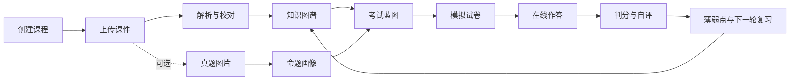

# 产品简报

版本：0.1
日期：2026-11-23
状态：需求验证中

## 1. 背景

理工科大学生在期末复习阶段通常同时面对大量课件、习题、公式、图表和代码。资料虽然齐全，但学生难以快速判断：

- 哪些内容最值得优先复习
- 不同章节和概念之间是什么关系
- 哪些公式、条件或代码行为容易混淆
- 自己的薄弱点究竟位于哪里
- 当前复习方式是否足以应对考试

通用 AI 对话工具可以总结资料，但容易脱离原始依据，也难以稳定遵守考试时长、题型、分值和难度结构。

## 2. 产品定义

暂定产品描述：

> 面向理工科大学生的本地优先 AI 复习工作台。以课程资料为依据生成可追溯的知识图谱，按可控考试蓝图生成模拟试卷，并通过答题结果定位薄弱点。

产品不以“聊天”为主界面，以“课程”和“学习闭环”为主界面。

## 3. 目标用户

首版用户：

- 中国高校理工科本科生
- 期末考试前 1 到 4 周集中复习
- 手中通常有课件，部分课程有图片格式的历年真题
- 能获取 OpenAI 兼容模型的 API Key，或愿意按照说明配置
- 对隐私敏感，希望资料留在自己的电脑上

首版验证课程：

- 线性代数：公式、矩阵、计算与证明
- 大学物理：公式、示意图、单位与实验分析
- 面向对象程序设计：代码、类关系与程序设计

验证课程不是功能白名单。产品应通过通用知识对象和可配置考试蓝图容纳大部分讲义型、习题型理工科课程。

## 4. 核心用户任务

1. 我上传课件后，希望快速看到这门课真正需要优先掌握的内容。
2. 我希望知道每个重点来自哪一页资料，而不是盲信 AI。
3. 我希望按照本课程的实际题型和分值生成一套模拟卷。
4. 我希望在线完成试卷，并知道哪些知识点没有掌握。
5. 我希望错题、收藏和历史试卷以后还能找回。
6. 我希望资料和模型 Key 不被上传到项目作者的服务器。

## 5. 核心闭环

## 6. 产品差异点

### 6.1 资料有出处

知识节点、题目和解析尽量关联原始文件、页码或幻灯片编号。无法从资料确认的内容必须标记为“AI 补充”或“待核验”。

### 6.2 试卷结构可控

先生成可编辑的考试蓝图，再生成试卷。系统必须在本地校验题型、题量、分值、难度和章节覆盖，不能只相信模型返回值。

### 6.3 学习闭环完整

不只生成内容，还记录作答、耗时、自评结果和错误原因，并把薄弱点映射回知识图谱和资料原文。

### 6.4 本地优先、自带模型

首版不建立公共 AI 额度池。用户自行配置 OpenAI 兼容接口，项目默认不保存用户课程资料到作者控制的服务器。

## 7. 产品原则

- 不把生成内容包装成考试预测或分数保证。
- 不用“看起来很完整”掩盖无法识别的公式、图表和扫描页。
- 不让模型自由决定最终分值结构。
- 不直接渲染模型输出的任意 HTML。
- 不把历年真题逐题照抄作为默认能力。
- 不在没有用户确认的情况下覆盖已有知识图谱或历史试卷。

## 8. 验证阶段成功标准

首版进入正式开发前，必须使用真实或高质量公开样例验证：

- 数字版 PDF 和 PPTX 的核心文字、公式与图片没有静默丢失。
- 三门验证课程各自能生成结构合格的知识图谱。
- 真题图片能提取题型、分值和章节分布，并允许用户修正。
- 试卷结构 100% 通过本地约束校验。
- 所有资料型知识节点都能追溯来源，或明确标记为补充内容。
- 用户能完成一次从上传到复盘的完整链路。

## 9. 明确不做

首版不包含：

- 用户社区、题库市场和公开分享
- 云账号与跨设备同步
- 自动执行用户代码
- 完全自动批改所有证明题、计算题和设计题
- 复杂电路图、CAD 图纸和化学结构式的自动生成
- 小程序客户端
- 由 AI 直接生成任意 HTML 网页
- 对真实考试结果的任何预测或保证
