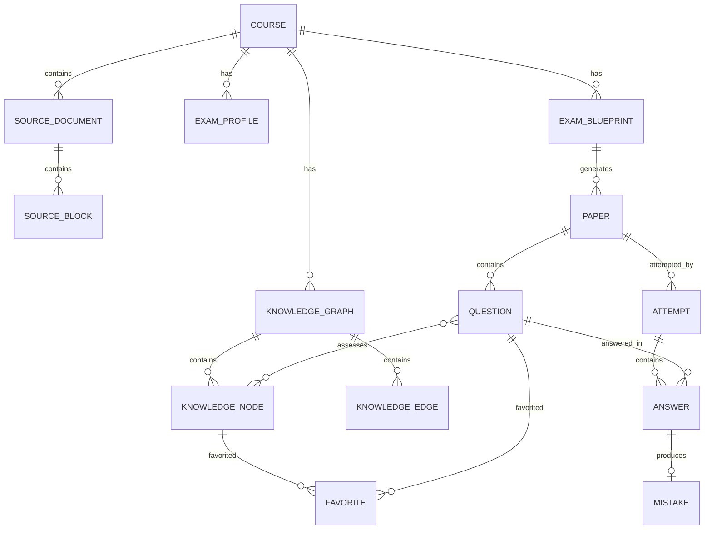

# 核心数据模型

版本：0.1
日期：2026-11-23

## 1. 设计目标

数据模型需要支持：

- 课程资料与原始位置追溯
- 公式、图片和代码等非纯文本内容
- 可版本化的知识图谱和试卷
- 作答快照与错题复盘
- 本地优先存储
- 不同 AI 服务商之间的可替换性

以下内容是实现前的领域模型，不代表最终数据库字段。

## 2. 实体关系



## 3. 通用字段

所有实体使用：

- `id`：本地生成的 UUID。
- `createdAt`：ISO 8601 时间。
- `updatedAt`：ISO 8601 时间。
- `schemaVersion`：数据结构版本。

课程、图谱、试卷和作答记录删除时优先使用明确的级联规则，不使用无法恢复的隐式覆盖。

## 4. 核心实体

### 4.1 Course

代表一门课程，是所有资料的归属中心。

| 字段 | 类型 | 说明 |
| --- | --- | --- |
| name | string | 课程名称 |
| subjectCategory | enum | math、physics、engineering、computerScience、chemistry、other |
| programmingLanguage | string | 编程语言，非代码课程可为空 |
| framework | string | 框架或技术栈，例如 MFC、Qt、Spring，可为空 |
| description | string | 用户说明 |
| defaultDurationMinutes | number | 默认考试时长 |
| defaultTotalScore | number | 默认总分 |
| customInstructions | string | 课程专属要求 |
| status | enum | active、archived |

### 4.2 SourceDocument

代表一份上传的课件、习题或真题图片。

| 字段 | 类型 | 说明 |
| --- | --- | --- |
| courseId | UUID | 所属课程 |
| kind | enum | courseware、exercise、pastExam、syllabus、other |
| filename | string | 原始文件名 |
| mimeType | string | 文件类型 |
| fileSize | number | 文件大小 |
| storageKey | string | 本地文件引用，不存公开 URL |
| parseStatus | enum | pending、parsing、partial、ready、failed |
| pageCount | number | 页数或幻灯片数 |
| parseWarnings | string[] | 空页、图片页、乱码等 |
| contentHash | string | 用于重复文件检测和缓存 |

### 4.3 SourceBlock

代表可引用的原文片段。

| 字段 | 类型 | 说明 |
| --- | --- | --- |
| documentId | UUID | 来源文档 |
| blockType | enum | text、heading、formula、image、table、code、unknown |
| order | number | 文档内顺序 |
| locator | object | 页码、幻灯片、段落或区域 |
| text | string | 可提取的字面内容 |
| markdown | string | 结构化文本，可包含 LaTeX 和代码块 |
| assetId | UUID | 图片或附件引用，可选 |
| extractionMethod | enum | native、ocr、vision、manual |
| confidence | number | 0 到 1，未知时为空 |

`locator` 示例：

```json
{
  "page": 12,
  "slide": null,
  "section": "4.2 特征值与特征向量",
  "paragraph": 3
}
```

### 4.4 Asset

保存图片、图表和公式截图。

| 字段 | 类型 | 说明 |
| --- | --- | --- |
| storageKey | string | 本地文件引用 |
| mimeType | string | 图片类型 |
| width | number | 像素宽 |
| height | number | 像素高 |
| altText | string | 可访问性描述或 AI 生成的图片说明 |
| sourceDocumentId | UUID | 来源文档 |
| sourceLocator | object | 来源位置 |

### 4.5 KnowledgeGraph

代表某一版本的知识图谱。

| 字段 | 类型 | 说明 |
| --- | --- | --- |
| courseId | UUID | 所属课程 |
| documentIds | UUID[] | 本次生成使用的资料 |
| generationJobId | UUID | 生成任务 |
| title | string | 图谱标题 |
| depth | enum | overview、standard、complete |
| focus | string[] | 用户选择或自定义侧重点 |
| summary | string | 课程重点摘要 |

### 4.6 KnowledgeNode

| 字段 | 类型 | 说明 |
| --- | --- | --- |
| graphId | UUID | 所属图谱 |
| nodeType | enum | definition、theorem、formula、method、experiment、figure、code、example、pitfall |
| title | string | 节点标题 |
| summary | string | 简要解释 |
| importance | enum | core、important、normal、extension |
| contentMarkdown | string | 包含 LaTeX 或代码的详细内容 |
| evidence | Evidence[] | 来源引用 |
| verificationStatus | enum | sourced、supplemented、uncertain |
| mastery | enum | unseen、shaky、developing、mastered |
| userNote | string | 用户笔记 |

### 4.7 KnowledgeEdge

| 字段 | 类型 | 说明 |
| --- | --- | --- |
| graphId | UUID | 所属图谱 |
| sourceNodeId | UUID | 起点 |
| targetNodeId | UUID | 终点 |
| relation | enum | prerequisite、contains、relatedTo、contrastsWith、appliesTo |
| label | string | 关系说明，可选 |

### 4.8 Evidence

用于知识节点和题目溯源。

| 字段 | 类型 | 说明 |
| --- | --- | --- |
| documentId | UUID | 来源文档 |
| blockId | UUID | 来源片段 |
| locator | object | 便于展示的页码或章节 |
| quote | string | 短引用，可选 |

补充内容使用：

```json
{
  "verificationStatus": "supplemented",
  "evidence": []
}
```

不得为补充内容伪造 `Evidence`。

### 4.9 ExamProfile

从真题图片提取出的命题画像，不等同于试卷。

| 字段 | 类型 | 说明 |
| --- | --- | --- |
| courseId | UUID | 所属课程 |
| sourceDocumentIds | UUID[] | 真题图片 |
| questionTypeDistribution | object[] | 题型、题量、分值 |
| difficultyDistribution | object | 基础、综合、拔高比例 |
| topicCoverage | object[] | 章节或知识点及比例 |
| commonPatterns | string[] | 常见问法和命题风格 |
| uncertainties | string[] | 无法识别或需要用户确认的区域 |
| confirmedByUser | boolean | 用户是否确认 |

### 4.10 ExamBlueprint

| 字段 | 类型 | 说明 |
| --- | --- | --- |
| courseId | UUID | 所属课程 |
| title | string | 考试名称 |
| durationMinutes | number | 考试时长 |
| totalScore | number | 总分 |
| difficultyRatio | object | 各难度百分比 |
| topicCoverage | object[] | 章节或知识点覆盖 |
| openBook | boolean | 开闭卷 |
| examProfileId | UUID | 可选真题画像 |
| customRequirements | string | 自定义要求 |
| sections | ExamSection[] | 题型分区 |

### 4.11 ExamSection

| 字段 | 类型 | 说明 |
| --- | --- | --- |
| title | string | 分区名称 |
| questionType | enum | 题型 |
| questionCount | number | 题数 |
| pointsPerQuestion | number | 单题分值，仅适用于所有题同分时 |
| sectionScore | number | 分区总分 |
| scoringGroups | object[] | 多小问或多分值结构，可选 |
| instructions | string | 作答说明 |

约束：

- 单一分值时：`questionCount * pointsPerQuestion = sectionScore`
- 使用 `scoringGroups` 时：各组 `questionCount * pointsPerQuestion = groupScore`
- `sum(scoringGroups.questionCount) = questionCount`
- `sum(scoringGroups.groupScore) = sectionScore`
- `sum(sectionScore) = totalScore`
- `sum(difficultyRatio) = 100`

`scoringGroups` 用于表达“本大题 14 分，其中第 1 小问 9 分、第 2 小问 5 分”这类结构，不能为了适配数据结构而把一个大题错误拆成两个独立大题。

### 4.12 Paper

试卷是蓝图生成后的不可变快照。

| 字段 | 类型 | 说明 |
| --- | --- | --- |
| courseId | UUID | 所属课程 |
| blueprintId | UUID | 来源蓝图 |
| version | number | 同课程内递增版本 |
| title | string | 试卷标题 |
| status | enum | draft、ready、archived |
| generationJobId | UUID | 生成任务 |
| modelLabel | string | 使用的模型名称 |
| questions | Question[] | 题目 |

修改单个题目时创建新版本，不覆盖已经开始的作答。

### 4.13 Question

| 字段 | 类型 | 说明 |
| --- | --- | --- |
| paperId | UUID | 所属试卷 |
| sectionId | string | 蓝图分区关联 |
| questionType | enum | 题型 |
| order | number | 顺序 |
| stemMarkdown | string | 题干 |
| options | object[] | 选择题选项 |
| points | number | 分值 |
| difficulty | enum | basic、integrated、advanced |
| knowledgeNodeIds | UUID[] | 考查知识点 |
| evidence | Evidence[] | 来源依据 |
| answer | AnswerKey | 参考答案 |
| explanationMarkdown | string | 解析 |
| rubric | RubricItem[] | 步骤或评分点 |
| gradingMode | enum | auto、rubricSelf、manual |
| assetIds | UUID[] | 题目相关图片 |

内容格式：

- 文本使用受控 Markdown。
- 公式使用 LaTeX。
- 代码使用带语言标识的代码块。
- 不保存或渲染未经净化的原始 HTML。

### 4.14 Attempt

| 字段 | 类型 | 说明 |
| --- | --- | --- |
| paperId | UUID | 作答的试卷快照 |
| startedAt | ISO 8601 | 开始时间 |
| submittedAt | ISO 8601 | 提交时间 |
| durationSeconds | number | 用时 |
| status | enum | inProgress、submitted、reviewed |
| totalScore | number | 得分 |
| maxScore | number | 满分 |
| answers | Answer[] | 作答 |

### 4.15 Answer

| 字段 | 类型 | 说明 |
| --- | --- | --- |
| attemptId | UUID | 作答记录 |
| questionId | UUID | 题目 |
| responseMarkdown | string | 用户答案 |
| selectedOptionIds | string[] | 选择题选项 |
| autoScore | number | 自动判分 |
| selfScore | number | 自评分数 |
| errorReasons | enum[] | 错误原因 |
| reviewNote | string | 复盘笔记 |

### 4.16 Mistake 与 Favorite

Mistake 保存错题快照与错误原因；Favorite 支持收藏知识节点或题目。

类型使用：

```text
targetType: knowledgeNode | question | paper
```

目标对象被新版本替换后，收藏和错题仍能展示快照。

### 4.17 ModelConfig

| 字段 | 类型 | 说明 |
| --- | --- | --- |
| providerLabel | string | 服务商名称 |
| baseUrl | string | OpenAI 兼容接口地址 |
| textModel | string | 文本模型 |
| visionModel | string | 视觉模型，可选 |
| capabilityStatus | object | 文本、视觉、上下文等检测结果 |

API Key 不进入普通领域数据表，也不应包含在课程导出文件中。

### 4.18 GenerationJob

| 字段 | 类型 | 说明 |
| --- | --- | --- |
| courseId | UUID | 所属课程 |
| jobType | enum | parse、knowledgeGraph、examProfile、paper、review |
| status | enum | queued、running、completed、failed、cancelled |
| model | string | 模型标签 |
| promptVersion | string | 提示词版本 |
| inputHash | string | 缓存和去重 |
| rawResponse | string | 原始响应，本地保存 |
| errorCode | string | 标准化错误 |
| usage | object | token 或调用统计，可选 |

## 5. 本地存储建议

首版采用本地存储适配层：

- 结构化数据使用本地 SQLite 或等效数据库。
- 原始文件和大图片保存在应用数据目录。
- 数据库只保存文件引用，不保存 Base64。
- 后端生成临时文件后应定期清理。
- 导出课程时生成独立目录或压缩包。

最终存储技术需在可行性验证后确定。

## 6. 数据完整性规则

1. 试卷题目分值之和必须等于蓝图总分。
2. 每道题至少关联一个知识点，或明确标记为综合题。
3. 每个 sourced 节点和题目必须至少包含一条有效 Evidence。
4. 失效来源不能伪装成仍然存在的页码引用。
5. 已收进错题本的题目必须保存内容快照。
6. 已开始的作答必须绑定生成时的试卷版本。
7. 删除课程时必须删除或明确孤立相关文件、生成记录和作答记录。
8. 任何导出文件不得包含 API Key。
