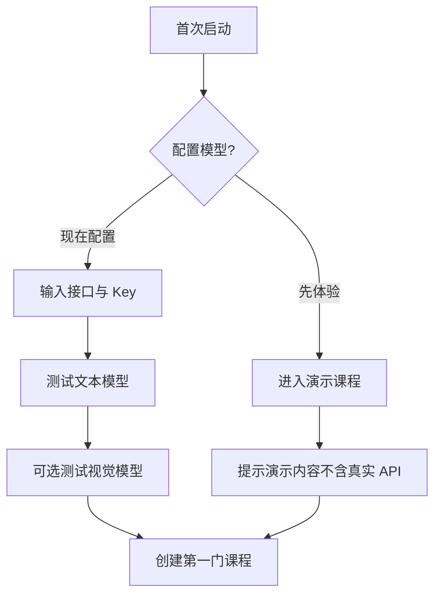

# 页面信息架构

版本：0.1
日期：2026-11-23

## 1. 信息架构原则

- 课程是主要组织单位。
- 首页直接进入可用工作台，不做营销落地页。
- 生成结果与原始资料始终可以互相跳转。
- 考试蓝图确认是出卷前的强制步骤。
- 历史、错题和收藏不孤立存在，均与课程和知识点关联。
- 桌面端优先，作答页兼容平板和手机。

## 2. 全局导航

左侧主导航：

- 课程
- 历史记录
- 错题本
- 收藏
- 设置

顶部全局操作：

- 当前模型状态
- 新建课程
- 本地数据状态

课程内二级导航：

- 概览
- 资料
- 知识图谱
- 模拟考试
- 学习记录

## 3. 首轮启动流程

首次启动只出现一个核心向导，不展示功能营销介绍。

## 4. 页面说明

### 4.1 课程列表

内容：

- 最近课程卡片
- 课程名称、学科、资料数、最近学习时间
- 创建课程按钮
- 空白状态和导入示例课程入口

主要操作：

- 新建课程
- 打开课程
- 归档课程

### 4.2 课程工作台

概览页展示：

- 当前复习进度
- 最近一次模拟考试
- 最需要复习的知识点
- 待处理解析警告
- 快速操作：上传资料、生成图谱、创建试卷

设计重点：

- 信息密度适中，优先展示下一步行动。
- 不使用大面积宣传文案。
- 不将核心工具放入嵌套卡片。

### 4.3 资料页

布局：

- 左侧资料列表
- 右侧解析预览和引用位置
- 顶部显示解析质量摘要

状态：

- 上传中
- 排队解析
- 部分成功
- 需要校对
- 解析失败

关键交互：

- 批量上传
- 拖放导入
- 查看空页和疑似公式图片
- 编辑提取文字
- 删除资料
- 将资料标记为课件、习题、真题或考试范围

### 4.4 知识图谱页

顶部：

- 生成选项
- 视图切换
- 导出入口，P1

主体：

- 大纲视图
- 关系图视图
- 重点清单

侧栏：

- 节点详情
- 来源原文
- 收藏和掌握度
- 关联题目和错题

交互要求：

- 点击节点不丢失当前缩放和位置。
- 无来源节点有明确标记。
- 关系图较大时支持聚焦当前节点。
- 不以动画作为理解知识关系的唯一方式。

### 4.5 真题命题画像页

内容：

- 原始图片预览
- 识别出的题型与分值
- 章节覆盖
- 难度分布
- 常见表述
- 未识别区域

操作：

- 修改识别结果
- 删除错误区域
- 确认画像
- 不使用该画像

### 4.6 考试蓝图页

布局：

- 基础设置：名称、时长、总分、开闭卷
- 题型分区编辑器
- 难度比例
- 章节覆盖
- 真题参考开关
- 自定义要求

右侧实时显示：

- 当前总分
- 题目总数
- 分值校验状态
- 章节覆盖校验状态

主按钮：

- 生成模拟试卷

校验不通过时按钮禁用，并定位到第一个错误。

### 4.7 试卷预览页

内容：

- 试卷标题与考试参数
- 各题型分区
- 公式、代码和图片
- 每题分值
- 题目质量标记

操作：

- 开始考试
- 替换单题
- 重生成单题
- 查看来源
- 保存版本

### 4.8 作答页

布局：

- 主区域：当前题目
- 侧边或抽屉：题号导航
- 顶部：倒计时、保存状态、交卷

状态：

- 未作答
- 已作答
- 已标记
- 自动保存中
- 保存失败

交卷前：

- 显示未答题
- 显示标记题
- 允许返回继续作答

### 4.9 结果复盘页

顺序：

1. 总分和用时
2. 各题型得分
3. 薄弱知识点
4. 错题逐题复盘
5. 下一轮复习建议

每道错题显示：

- 用户答案
- 正确答案
- 评分点
- 来源依据
- 错误原因
- 加入错题本

### 4.10 历史记录

筛选：

- 课程
- 类型：图谱、试卷、作答
- 时间

历史项展示：

- 创建时间
- 模型
- 版本
- 简要结果
- 打开或删除

### 4.11 错题本

筛选：

- 课程
- 知识点
- 错误原因
- 掌握状态

操作：

- 重新练习
- 查看原试卷
- 标记已掌握
- 移出错题本

### 4.12 收藏

收藏内容分为：

- 知识节点
- 题目

保留原课程和来源引用。

### 4.13 设置

分区：

- 模型与 API
- 生成偏好
- 本地数据
- 隐私说明
- 关于

本地数据页显示：

- 文件占用
- 数据库占用
- 可清理缓存
- 导出课程
- 删除全部数据

## 5. 关键跨页面流程

### 5.1 资料到知识图谱

`资料页 -> 解析完成 -> 生成知识图谱 -> 图谱页`

任一解析页面失败时，允许用户继续使用已成功部分，但必须显示覆盖缺口。

### 5.2 真题到考试蓝图

`资料页 -> 标记为真题 -> 命题画像 -> 用户确认 -> 考试蓝图`

### 5.3 试卷到能力复盘

`蓝图 -> 试卷预览 -> 作答 -> 结果 -> 知识点详情 -> 下一轮复习`

## 6. 空状态与错误

- 无课程：提供创建课程和导入示例课程。
- 无资料：说明可支持格式，不承诺未验证能力。
- 无图谱：显示生成所需的最低资料条件。
- 模型未配置：提供配置入口和演示模式。
- 模型视觉能力未知：在图片导入时提示检测。
- 解析失败：显示具体文件和失败原因。
- 生成结构不合格：保存原始响应并提供重试，不展示半成品为成功。

## 7. 移动端策略

首版优先保证：

- 在线作答
- 查看结果
- 查看知识节点和来源

复杂编辑操作在窄屏上提示使用桌面端，但不阻止基本查看和答题。
